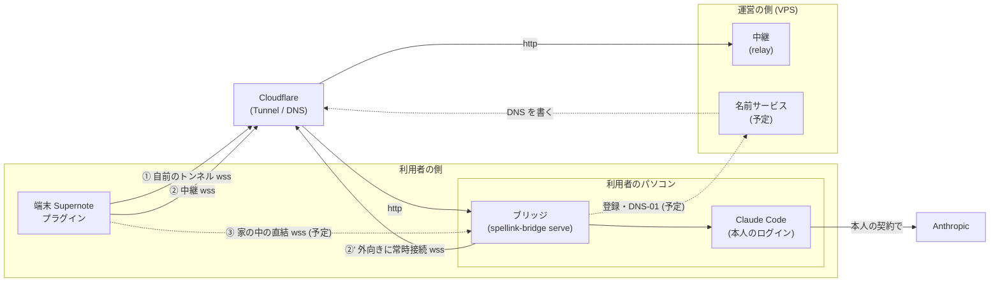
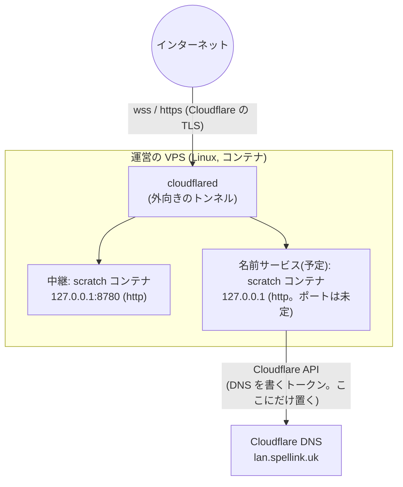
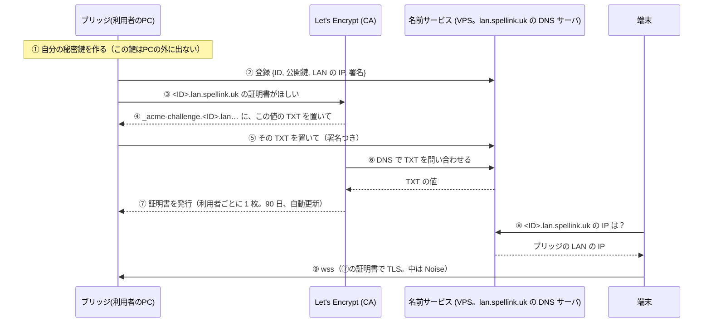
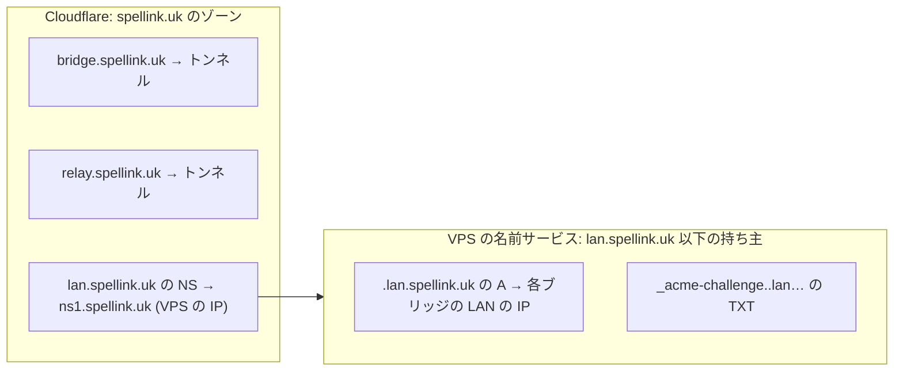

# Spellink の構成: 誰が何を持ち、どこで TLS を張るか

運営する人と、レビューする人のための**構成図**。利用者向けの説明は `bridge-and-relay-for-users.md`、中継の手順は `relay-operations.md`、決定の理由は ADR（0005・0007・0010・0011・0016・0017・0018）。

最終更新: 2026-11-21。**「いま」と書いたものは実装済み、「予定」と書いたものは未実装。**

## 1. 登場人物

| 登場人物 | 何者か | 持っているもの |
|---|---|---|
| **端末**（Supernote） | 手書きを読み取る。プラグインが動く | 自分用の秘密 K（ペアリングで受け取る）、接続先の一覧 |
| **ブリッジ**（`spellink-bridge serve`） | 利用者の**自分のパソコン**で動く。AI に聞く | 端末の台帳（B・K）、会話の履歴、AI ツール（Claude Code）のログイン |
| **AI**（Claude Code） | ブリッジのパソコンに入っている公式 CLI | 利用者本人の契約・ログイン（ブリッジも運営も触れない） |
| **中継**（`spellink-bridge relay`） | **運営**の VPS で動く。外出先の端末とブリッジをつなぐ | 何も持たない（状態はメモリだけ） |
| **名前サービス**（予定。ADR 0017） | **運営**の VPS で動く。家の中の直結のための名前と証明書を手伝う | ID と LAN の IP、DNS を書く Cloudflare のトークン |
| **Cloudflare** | 運営（と一部の利用者）が使う、入口とトンネルと DNS | 通過する暗号文、接続元の IP |

**利用者は自分のパソコンでブリッジを動かす。** 運営は、中継（と予定の名前サービス）だけを動かす。AI への質問は、利用者のパソコンから AI に直接行き、運営を通らない。

## 2. 全体図

端末は、設定された経路を**同時に**試し、つながったものを使う（家なら③、外なら②か①）。

## 3. TLS はなぜあり、どこからどこまでか

- 端末の PluginHost は、**公的な CA の `wss://` しか接続させない**（`ws://` や `.local` は拒否。ADR 0007）。TLS は、この制約を満たすためにある。
- **中身の秘密は TLS ではなく Noise が守る。** 端末とブリッジの間は、端末とブリッジだけが持つ鍵で暗号化している（`Noise_NNpsk0_25519_ChaChaPoly_BLAKE2s`）。TLS を終端する Cloudflare にも中継にも、質問と回答は見えない。
- つまり TLS は「区間ごとの入口の鍵」、Noise は「端から端までの鍵」。

| 経路 | TLS を張る区間（誰が証明書を持つか） | その先 | 端から端までの暗号 |
|---|---|---|---|
| **① 自前のトンネル**（いま。開発者本人が使用中） | 端末 ⇄ **Cloudflare の入口**（Cloudflare の証明書） | `cloudflared` が外向きに張った線で、パソコンの `127.0.0.1:8765` へ平文の http | Noise（端末 ⇄ ブリッジ） |
| **② 中継**（いま。公開は運営の判断待ち） | 端末 ⇄ **Cloudflare の入口**。ブリッジ ⇄ Cloudflare の入口（ブリッジが外向きに常時接続） | VPS の `cloudflared` から、中継へ `127.0.0.1:8780` で平文の http | Noise（端末 ⇄ ブリッジ。中継は暗号文を流すだけ） |
| **③ 家の中の直結**（予定。ADR 0017） | 端末 ⇄ **ブリッジ**（`<id>.lan.spellink.uk` の証明書。**秘密鍵はブリッジの外に出ない**） | 直接。Cloudflare も中継も通らない | Noise（同じ） |

**②の中継そのものは、いま TLS を話さない**（平文の http で `127.0.0.1` だけを待ち受ける）。TLS を張るのは前段の Cloudflare Tunnel。中継の入口に TLS を持たせる選択肢は `docs/notes/research/2026-11-21-relay-tls-in-scratch.md`。

## 4. ペアリングと接続の流れ（ADR 0016）

1. 利用者が、ブリッジで「端末を追加」。端末専用の `.snplg` ができる（初期の秘密 B を入れる。期限 24 時間、ペアリングにだけ使える）。
2. 端末に `.snplg` を入れ、「ペアリング」を押す。端末が 8 桁の数字と QR を出す。
3. 利用者がブリッジに数字を入力（または QR を読む）。一致したら、ブリッジが本番の秘密 K を、B から作った Noise の通信路で端末に渡す。**B はここで破棄される。**
4. 以後は K だけで話す。接続先の一覧（①②③）も、このとき端末に渡る。

質問のとき: 端末が OCR した文字を Noise で送る → ブリッジが Claude Code に聞く → 答えをストロークにして Noise で返す。**中継・Cloudflare・名前サービスは、この中身を見ない。**

## 5. 誰が何を見られるか

| | 質問・回答 | 秘密 K・B | 接続元の IP | 端末・ブリッジの ID | 通信量・時刻 |
|---|---|---|---|---|---|
| 端末・ブリッジ | ○ | ○ | – | ○ | ○ |
| 中継（運営） | **見えない** | **見えない** | 前段のヘッダの値（ログには書かない） | 部屋 ID（K のハッシュ）だけ | ○ |
| Cloudflare | **見えない**（暗号文） | **見えない** | ○ | ホスト名 | ○ |
| 名前サービス（予定） | **見えない** | **見えない** | 登録のときの接続元 | ブリッジの ID と LAN の IP | 登録の時刻 |
| 運営の人 | 見えない | 見えない | Cloudflare のログにだけ | 部屋 ID | 集計 |

## 6. 運営と利用者の役割

| | 運営（Spellink） | 利用者 |
|---|---|---|
| 動かすもの | 中継、名前サービス（予定）、ドメイン `spellink.uk`、Cloudflare のアカウント | ブリッジ、Claude Code、端末 |
| 持つ秘密 | Cloudflare のトンネルの資格情報、**DNS 用の API トークン（名前サービスの機械にだけ）** | 自分の AI のログイン、端末ごとの K、ブリッジの台帳 |
| 持たないもの | 利用者の質問・回答・AI の認証・K | 運営の資格情報 |
| 止まったとき | 外出先から使えない。家の中（③）は取得済みの証明書の期間（90 日）使える | ブリッジの `relayUrl`・`extraUrls` を変えれば、自前の中継やトンネルへ移れる |
| 費用 | VPS、ドメイン | AI の契約（本人の枠）、パソコンの電気 |

**境界の原則:** 運営の資格情報（Cloudflare トークン）は、運営の VPS の外に出さない。利用者のリポジトリ・バイナリ・`.snplg` にも入れない。利用者の秘密（K・AI のログイン）は、運営の機械に送らない。

## 7. 運営する部品の配置

中継と名前サービスは、同じ静的な 1 つのバイナリ（サブコマンドが違う）。コンテナは `FROM scratch`（シェルも OS のライブラリもない）。VPS は外から**ポートを一つも開けない**（トンネルは外向き）。

## 8. 公開前に確かめること

- 利用中のトークンが、git の履歴と追跡ファイルに**ない**こと（2026-11-21 に確認。下の §9）。
- セキュリティレビューとコードレビュー（ユーザー指定。実施前は push しない）。
- `Dockerfile.relay` を docker のある機械でビルドして動かす（この開発機には docker がない）。
- 名前サービスの設計の確認（ADR 0017）と、ドメイン・トークンの判断。
- 利用規約・プライバシーの文書（`docs/notes/research/2026-11-20-relay-decisions.md`）。

## 9. トークンが出ていないことの確認（2026-11-21、push 前）

- 方法: 開発機のブリッジの設定（`config.json`・`devices.json`）にある秘密の文字列を取り出し、**全ブランチ・全コミットの全ファイル**（`git grep -F` を `git rev-list --all` の各コミットに）と、作業ツリー（ignore された物を含む）を照合した。値は画面にも文書にも出していない。
- 結果: 履歴・追跡ファイルに**一致なし**。作業ツリーで一致したのは `plugin/src/bridges.local.json` だけで、これは `plugin/.gitignore` で除外され、一度もコミットされていない。
- 形のパターン（`sk-ant`、`Bearer …`、`CF_API_TOKEN`、秘密鍵の PEM）も履歴を検索し、該当なし。
- 追跡されている `plugin/android/app/debug.keystore` は React Native の標準のデバッグ用（公開された既定のパスワード）で、秘密ではない。配布版の署名には使わない。
- **限界:** 照合できるのは、開発機に現にある値だけ。過去に作り直して捨てた古いトークンは照合できない。push 前に、`gitleaks` などの専用の道具でも全履歴を検索する（この開発機には未導入）。

## 10. 証明書と CA はどこに立つか（名前サービス案。2026-11-21 検討中）

**CA は Let's Encrypt（公的な CA）だけ。自前の CA は立てない。** 端末が信頼するのは公的な CA だけで、自前の CA は端末に入れられないため。

### 10.1 中継と名前サービスは別の仕事（置き換えではない）
| | 中継 | 名前サービス |
|---|---|---|
| 役目 | **外出先**の端末とブリッジをつなぐ（ブリッジは家のルーターの内側で、外から入れない） | **家の中**で、端末がブリッジに**直接**つなげるよう、名前と証明書を用意する |
| なくなると | 外出先から使えない | 家でも中継経由になる（遅くなるだけ） |

名前サービスがあっても、外出先のために中継は要る。両方を同じ VPS で動かす。

### 10.2 利用者ごとの証明書を取る流れ

### 10.3 DNS の委任（Cloudflare 側の設定は、これだけ）
`spellink.uk` のゾーン（Cloudflare）に、`lan` の **NS レコード**を足して、`lan.spellink.uk` 以下の問い合わせを VPS の名前サービスに任せる。`bridge.`・`relay.` など、ほかの名前は Cloudflare のまま。

- Cloudflare の API トークンは**要らない**（レコードの数の上限も受けない）。名前サービスが触れるのは `lan.spellink.uk` 以下だけ（委任された範囲）。
- 代わりに、VPS で **UDP/TCP 53 を開ける**。小さな応答だけを返す（増幅攻撃に使われない）、回数制限を付ける。

### 10.4 経路ごとの CA と、秘密鍵の持ち主
| 経路 | 名前 | 証明書を出す CA | 秘密鍵の持ち主 |
|---|---|---|---|
| ① 自前のトンネル | `bridge.spellink.uk`（利用者は自分のドメイン） | Cloudflare（入口で TLS を終端） | Cloudflare |
| ② 中継 | `relay.spellink.uk` | Cloudflare（いま）／Let's Encrypt（中継が自分で TLS を話す場合） | Cloudflare／中継 |
| ③ 家の直結 | `<ID>.lan.spellink.uk`（利用者ごとに別の名前・別の証明書） | **Let's Encrypt** | **各利用者のブリッジ（外に出ない）** |

### 10.5 全員で 1 枚の `*.lan.spellink.uk` を配らない理由
- ワイルドカードの秘密鍵を全員のブリッジに配ることになる。**誰か 1 人の PC から鍵が漏れると、全員の名前を騙れる。** 漏れたら失効が必要で、全員が止まる。
- 認証局の規約は、証明書の秘密鍵を他人に配ることを許していない。違反すると失効されうる。
- 利用者ごとの名前と証明書にすれば、漏れても**その 1 人だけ**。同じ方式の前例がある（Plex が、利用者ごとの名前と証明書で家の直結をしていると理解している。要確認）。
- 通信の中身は、証明書が漏れても Noise が守る（TLS は入口の鍵、Noise は端から端までの鍵）。

### 10.6 Let's Encrypt の上限との関係
- 新規 50 枚/週/登録ドメイン = **新しく直結を使い始める人が週 50 人まで**。更新は同じ名前なら上限を受けない。総数の上限ではない。
- 同じドメイン `spellink.uk` で足りる（中継の証明書は 1 枚で、ほぼ影響しない）。超えそうなら、予備の CA（Google Trust Services）、登録ドメインの追加、例外申請。
- 上限を超えても、直結が遅れるだけで、中継で使える。
